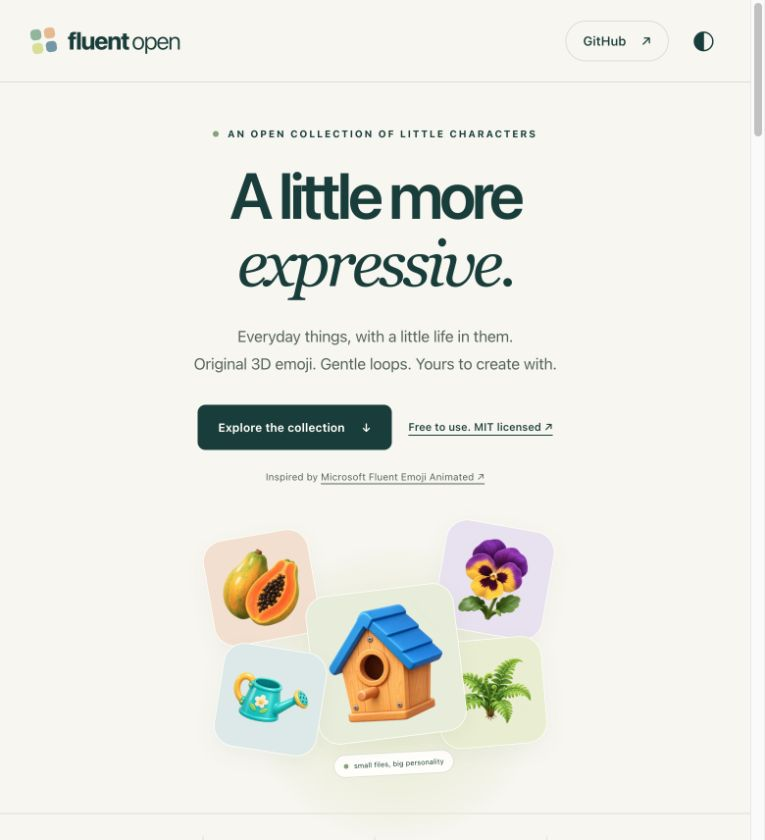

# Fluent Open · Animated Emoji

**Original 3D emoji, transparent animated AVIF loops, editable motion recipes, and a fast static showcase.** MIT licensed.

This independent community collection is based on the visual language and expressive motion of [Microsoft Fluent Emoji Animated](https://github.com/microsoft/fluentui-emoji-animated). See Microsoft's [animated asset collection](https://github.com/microsoft/fluentui-emoji-animated/tree/main/assets) and the companion [Fluent Emoji project](https://github.com/microsoft/fluentui-emoji).

The emoji here are original AI-generated illustrations with locally authored motion recipes. No Microsoft binary assets were copied into this release. This project is maintained by Tuấn Điệp and is not an official Microsoft release.

[](https://tuandiep98.github.io/fluentui-emoji-animated-open/)

**[Open the live showcase →](https://tuandiep98.github.io/fluentui-emoji-animated-open/)**

## Explore

Open [`index.html`](index.html) directly in a modern browser. No installation, network connection, CDN, font service, or build step is needed for the showcase. Animated AVIF support varies by browser; still PNG and WebP are included.

For local HTTP preview:

```sh
npm ci
npm run dev
# http://127.0.0.1:4173
```

Search names and translations in nine languages, filter categories, preview motion, switch light/dark backgrounds, and download individual assets. Animations load only on hover, keyboard focus, or explicit playback. Automatic motion respects reduced-motion and data-saver preferences.

## What's included

<!-- EMOJI-STATS:START -->
**520 emoji · 11 categories**

| Category | Emoji |
| --- | ---: |
| Home | 115 |
| Kitchen | 50 |
| Garden | 50 |
| Fruit & vegetables | 50 |
| Food & drink | 50 |
| Wildlife | 90 |
| Clothing | 40 |
| School & art | 40 |
| Vehicles | 15 |
| Places & community | 10 |
| Nature | 10 |
| **Total** | **520** |
<!-- EMOJI-STATS:END -->

The initial release combined 130 emoji and a further 100. A further 100 emoji add 20 meals, 30 wildlife, 30 clothing, and 20 school/art objects; their import record is in [`provenance/next-100-2026-11-09.json`](provenance/next-100-2026-11-09.json). The live totals above are generated from the current reviewed assets. Every asset includes:

- Original transparent `source.png` master.
- Optimized transparent `still.png` and `still.webp`, 256 × 256 pixels.
- Three-second `animated.avif`, 256 × 256 pixels, at most 60 KiB.
- Editable `motion.json`, vocabulary `meta.json`, and hash-bound `review.json`.
- Vocabulary metadata in English, Vietnamese, German, Spanish, French, Indonesian, Japanese, Korean, and Simplified Chinese.

[`catalog.json`](catalog.json) is the complete machine-readable index. [`provenance/import.json`](provenance/import.json) records the source release and imported IDs. Source masters and recipes are retained so future variants can be created without reverse-engineering compressed animations.

### Automatic collection counts

The table above is generated by `npm run catalog` directly from the reviewed assets in `assets/`. It counts only `ready` entries whose files match their approved review hashes. Drafts are excluded. New emoji and populated categories update the total, category count, and table automatically when you rebuild the catalog; empty categories are omitted.

GitHub renders a static README, so the counts refresh when the generated README is committed. After adding or changing an emoji, run:

```sh
npm run catalog  # updates catalog.json, showcase/catalog.js, README statistics and index.html counts/filters
npm run check
```

Commit all generated files with your asset. Keep the `EMOJI-STATS` markers in place and let the command maintain the content between them.

## Use an emoji

```html
<!-- Static, lightweight default -->
<picture>
  <source srcset="assets/birdbath/still.webp" type="image/webp">
  
</picture>

<!-- Use animated AVIF when the user requests motion -->

```

AVIF color and alpha sequences are included in the same file. Preserve transparency when processing these files; some image tools expose only the still cover frame. Provide a still fallback and respect your users' motion preferences.

## Create a new emoji

Requirements: Node.js 22 or later, npm, `ffmpeg`/`ffprobe`, and an AV1 encoder (`libaom-av1` in FFmpeg or `avifenc`). On macOS:

```sh
brew install ffmpeg libavif
npm ci
npm run new -- rain-boot --name "rain boot" --category garden --vi "ủng đi mưa"
# Generate an original transparent master from assets/rain-boot/prompt.md;
# save it as assets/rain-boot/source.png.
npm run stills -- rain-boot
# Edit assets/rain-boot/motion.json for object-specific movement.
npm run animate -- rain-boot
npm run review -- rain-boot
# Inspect out/review/rain-boot.png AND play the AVIF before approving.
npm run approve -- rain-boot
npm run catalog
npm run check
```

The toolkit scaffolds prompts and renders motion. The image-generation step is provider-independent: use your image tool to create the PNG, then record the exact prompt, tool, and corrections in `prompt.md`. No API key or proprietary image service is required to render the included source artwork.

Read the full [generation guide](docs/GENERATING.md) for recipe structure, precise commands, revision safeguards, and quality gates.

## Grow this collection with AI

Everyone is welcome to help this open source grow. You can ask an AI assistant to create a new emoji, author motion that suits the object, and package it using this repository's structure and commands. Start with the [generation guide](docs/GENERATING.md) and an existing asset as a reference.

For example, give your AI assistant this task:

> Read README.md and docs/GENERATING.md. Help me add an original emoji for [object] with ID [unique-slug]. Follow assets/<emoji-id>/ and the existing metadata and motion schemas. Create a transparent source.png, prepare PNG/WebP stills, and render an object-specific three-second AVIF loop within the size limit. Record the actual image prompt and tool in prompt.md. Generate the review contact sheet, then wait for my visual review before approval. After approval, rebuild the catalog and README counts and run the checks.

To contribute:

1. Fork the repository and create a branch for your new emoji.
2. Include the original master, stills, animation, recipe, metadata, prompt notes, and approved review record in `assets/<emoji-id>/`.
3. Inspect the still, decoded contact sheet, and actual animated playback. AI assistance does not replace this visual review.
4. Run `npm run catalog` and `npm run check`. Include the updated catalogs and README statistics.
5. Open a pull request describing the emoji, its motion, the generation tool used, and the review you performed. Include a preview where possible.

Contribute original artwork that you can share under this repository's MIT license. Useful additions include new objects, better translations, improved details, and more expressive motion. Each accepted contribution makes the shared source richer for everyone.

## Repository structure

```text
assets/<emoji-id>/
  source.png          # original transparent master
  still.png           # normalized 256px lossless still
  still.webp          # lightweight showcase still
  animated.avif       # transparent 3-second loop, <= 60 KiB
  motion.json         # local deformation / transform / effects
  meta.json           # identity, category, vocabulary, license
  review.json         # reviewed file hashes
  prompt.md           # prompt and generation notes for newly authored assets
catalog.json          # full index, paths, motion data and hashes
index.html            # standalone showcase entry
showcase/             # CSS, JS and generated compact search index
scripts/              # CLI, validation, catalog builder and motion renderer
provenance/           # import manifest and original production evidence
out/review/           # local review artifacts (ignored by Git)
```

## Performance

The showcase uses plain HTML, CSS, and JavaScript. It starts with 24 cards, lazy-loads still WebP, reveals 24 more on request, and limits gallery playback to three visible icons. Leaving the viewport or hiding the tab stops playback; opening details stops gallery motion. No animation file is requested during initial rendering. The compact search index covers the full collection without fetching the full metadata catalog. See [performance notes](docs/PERFORMANCE.md).

## GitHub Pages deployment

The live showcase is deployed by [GitHub Actions](https://github.com/Tuandiep98/fluentui-emoji-animated-open/actions/workflows/pages.yml) on every push to `main`. You can also run the workflow manually from the Actions tab. Repository Settings → Pages must use **GitHub Actions** as the source.

```sh
npm run build:pages
```

This refreshes the catalogs and README counts, then assembles `_site/` using Node built-ins. No dependency installation or image re-encoding is needed. The artifact includes the showcase, downloadable emoji, documentation, catalog, and license. Git history, dependencies, local review output, and authoring scripts are excluded. All site links use relative paths so the repository subpath works on Pages.

## License & attribution

The source, original artwork, metadata, and motion recipes in this repository are released under the [MIT License](LICENSE), copyright © 2026 Tuấn Điệp.

Microsoft's upstream project is separately [MIT licensed, copyright Microsoft Corporation](https://github.com/microsoft/fluentui-emoji-animated/blob/main/LICENSE). Its name is used for attribution and inspiration. See [third-party notices](THIRD_PARTY_NOTICES.md). If you add upstream Microsoft assets later, preserve their original license and notices alongside them.

### Capybara cutout motion study

[Compare the old and new animation live](https://tuandiep98.github.io/fluentui-emoji-animated-open/motion-lab/capybara/). The capybara asset now uses six separately painted parts, independent head/ear/eye tracks and a transparent 24fps AVIF. All source parts are embedded in `assets/capybara/motion.json`; the website only loads rendered images.

### Motion refinement: the latest 100 words

[Compare all 100 before and after](https://tuandiep98.github.io/fluentui-emoji-animated-open/motion-lab/next100/). Reviewed 100: refined 81 and retained 19 appropriate existing animations. The update includes 35 painted cutout rigs and 46 timed material/use gestures. Animal timing differs for sniffing, alert ears, browsing, curiosity, nods and heavy horns; rigid hardware keeps its shape. Vocabulary and translations are unchanged. Optional rig-source.png preserves the original generated parts atlas; its hash is included in review metadata. The browser only downloads rendered PNG/WebP/AVIF, never authoring rigs.

## Original-artwork fidelity pilot — Lynx

[View the isolated lynx correction](https://tuandiep98.github.io/fluentui-emoji-animated-open/motion-lab/lynx-source-lock/): original artwork, previous cutout and corrected motion side by side, with 64/128/256px and light/dark controls. This is a review candidate; the main collection is unchanged.

### Pages deployment size

Pages publishes stills, animations, recipes and review metadata. Large source.png masters and rig-source.png atlases remain in this Git repository; the deployed showcase Master link opens the original image on GitHub at the exact deployed commit. This keeps source artwork available while reducing the Pages synchronization artifact. Local previews continue to use local masters.

> **Artwork correction:** the earlier painted cutouts for 36 emoji have been superseded by original-artwork motion. [Compare original, previous and corrected images](https://tuandiep98.github.io/fluentui-emoji-animated-open/motion-lab/original-fidelity/).

## Original artwork fidelity rule

[Compare all 36 corrected emoji](https://tuandiep98.github.io/fluentui-emoji-animated-open/motion-lab/original-fidelity/). Reviewed the latest 100: restored 27 animal and 9 object artworks to their exact original images, keeping the other 64 stills. The earlier painted cutout refinements for these 36 IDs are superseded.

Every new or revised animation must freeze the approved original before authoring. Preserve camera, facing, silhouette, markings and proportions. No repainted, mirrored or detached parts. Use continuous local motion from the same pixels, or a rigid presentation for hard objects. Each corrected asset includes reference.png and a sourceLock recipe. Larger articulation needs a separately reviewed reconstruction that matches the original rest image first. See docs/GENERATING.md.

## 30 new birds and marine animals — 2026-11-10

[Preview the 30 new emoji and compare each original with its animation](https://tuandiep98.github.io/fluentui-emoji-animated-open/motion-lab/next30/).

15 birds + 15 marine animals, nine-language metadata, original transparent masters,
immutable references and measured source-locked recipes. Every animation is 3 seconds,
24 fps and below 60 KiB. The gallery loads AVIF on interaction, runs at most two icons
and stops animation outside the viewport or in hidden tabs. Reduced motion and data
saving disable hover autoplay. Hard shells stay rigid; local animal gestures preserve
the original anatomy and facing. Prompts and exact rebuild recipes live with each asset.

## 30 more birds and aquatic animals — 2026-11-10

[Preview selection B: 30 new emoji, original still beside animation](https://tuandiep98.github.io/fluentui-emoji-animated-open/motion-lab/next30b/).

15 birds + 15 aquatic animals, all nine-language metadata and MIT source masters.
Each original is frozen before motion; measured continuous fields preserve anatomy,
facing, fixed anchors and at least 96% silhouette overlap. Seven decoded samples were
reviewed on light and dark backgrounds. Every AVIF is 3 seconds, 24fps and <=60KiB.
The gallery loads motion on interaction, runs at most two cards and stops offscreen
or hidden animations; hover autoplay respects reduced motion and data saving.

Each asset includes its exact prompt, immutable reference, final recipe and review hashes.
Use the existing `npm run animate -- <id>` / review / approve workflow to extend the collection.

## 10 everyday beginner words — 2026-11-10

[Preview: 10 easy words, original still beside animation](https://tuandiep98.github.io/fluentui-emoji-animated-open/motion-lab/next10-easy/).

Doll, toy blocks, rubber duck, beach ball, comb, towel, shampoo, toothpaste, tissue
and mop. Every asset includes a transparent master, immutable reference, motion
recipe, prompt, review hashes and metadata in nine languages. All are original
AI-generated artwork distributed under MIT. AVIF loops are 3 seconds at 24fps
and at most 60KiB; soft details move continuously and rigid objects keep their geometry.

### Easy words first

For future vocabulary additions, prioritize familiar everyday objects and core
actions for young beginners, then medium and advanced vocabulary. Specialist
terms and uncommon species follow the easier pool unless a contributor is
explicitly working on a specialist theme. Difficulty is an editorial familiarity
judgment, not a formal CEFR rating. The source still must remain recognizable
throughout motion: preserve facing, attachments, exact rest pose and silhouette.

Ask an AI assistant to follow the existing scaffold, create an original transparent
master and measured source-locked motion, then run the review/approve/catalog
commands described above. Contributions following that structure grow the
collection; README totals and category counts regenerate with `npm run catalog`.

## 30 more everyday beginner words — 2026-11-10

[Preview: 30 easy words, original still beside animation](https://tuandiep98.github.io/fluentui-emoji-animated-open/motion-lab/easy30/).

15 care and household objects, 10 familiar toys and 5 common vehicles.
The easy-first editorial selection follows the collection's beginner vocabulary
policy. New vehicle entries use the `vehicles` category; category filters and
README counts are generated with `npm run catalog`.

Every original is assembled and frozen before motion. Cloth, paper, pinwheel
blade tips, puppet arms and the skipping-rope loop use measured continuous
fields; rigid assemblies stay intact. Each loop is 3 seconds at 24fps and
at most 60KiB. Exact neutral pixels, fixed anchors, facing, geometry, bounds,
loop and at least 96% silhouette overlap were checked. Seven decoded samples
per icon were reviewed on light and dark backgrounds.

Each `assets/<id>/` contains the MIT transparent source master, reference,
PNG/WebP stills, AVIF, recipe, nine-language metadata, exact prompt and review
hashes. The rope's rejected first draft included a person: the recorded
correction removed that person before freezing the approved object-only art.
Use the existing scaffold and `animate` / `review` / `approve` commands to
contribute more familiar words and grow this open collection with AI assistance.

## 30 more easy words: toys, household objects and places — 2026-11-10

[Preview: 30 new easy words, original beside animation](https://tuandiep98.github.io/fluentui-emoji-animated-open/motion-lab/easy30b/).

10 familiar toys, 10 household objects and 10 everyday places, with nine-language
metadata. Easy words come first. The new `community` category, filters and README
counts update through `npm run catalog` as contributions arrive.

Original artwork is frozen before animation. Cotton fibers, laundry, feather
tips and attached awning hems use measured continuous fields. Rigid objects
keep their complete shape and joins. No mirroring or reassembly. Exact neutral
pixels, fixed anchors, facing, loop, bounds, deformation and at least 96%
silhouette overlap pass checks. Seven decoded samples per icon were inspected
on light/dark backgrounds; this is not real-time playback review of every icon.
All loops are 3 seconds at 24fps, each at most 60KiB.

Each `assets/<id>/` includes the transparent MIT master, immutable reference,
PNG/WebP stills, AVIF, recipe, translations, exact prompt and review hashes.
The bouncy ball's first draft had an unwanted external color halo; its recorded
AI correction removed that halo before the approved reference was frozen.
Ask AI to follow this structure and contribute more familiar emoji with the
existing scaffold, animate, review and approve commands.

## 30 more easy words: accessories, school and nature — 2026-11-10

[Preview: 30 new easy words, original beside animation](https://tuandiep98.github.io/fluentui-emoji-animated-open/motion-lab/easy30c/).

10 familiar accessories, 10 school/art supplies and 10 common natural features,
with nine-language metadata. Easy words come first. The new `nature` category
and collection counts update automatically through `npm run catalog`.

Every original is finalized and frozen before animation. Fabric wings, paper
edges, dough, water reflections and tree canopies use measured continuous
fields. Metal assemblies, paper folds and rigid objects stay intact. Fixed
water banks, rocks, wooden fan ribs and tree trunks are preserved. Exact neutral
pixels, fixed anchors, facing, geometry, loop, bounds and at least 96%
silhouette overlap pass checks. Seven decoded samples per icon were reviewed
on light/dark backgrounds; not real-time playback review of every icon.
Each AVIF is 3 seconds, 24fps and at most 60KiB.

The recorded image edits remove unwanted halos from the hairband, earrings
and puddle, and clarify the lake's water reflections before final still approval.
Each `assets/<id>/` contains a transparent MIT master, frozen reference, PNG/WebP
stills, AVIF, motion recipe, translations, exact prompt and review hashes.
Ask AI to follow this structure and contribute more familiar emoji through
the scaffold, animate, review and approve commands to grow the open collection.

## 30 more easy words: toys, school and vehicles — 2026-11-10

[Preview: 30 new easy words, original beside animation](https://tuandiep98.github.io/fluentui-emoji-animated-open/motion-lab/easy30d/).

10 familiar toys/instruments, 10 school/art supplies and 10 everyday vehicles,
with nine-language metadata. Easy words come first. Collection and category
counts update automatically with `npm run catalog`.

Every original is finalized before animation. Measured continuous fields move
only soft fabric, paper and toy details while anchors stay fixed. Rigid vehicles
and assemblies keep their exact facing, parts and joins. No mirrored pieces or
reassembly. Exact neutral pixels, fixed anchors, bounds, loop, deformation and
at least 96% silhouette overlap pass checks. Seven decoded samples per icon
were reviewed on light/dark backgrounds, not real-time playback of every icon.
Every AVIF is 3 seconds, 24fps and at most 60KiB.

Each `assets/<id>/` includes a transparent MIT master, immutable reference,
PNG/WebP stills, AVIF, motion recipe, translations, exact prompt and review
hashes. Ask AI to follow this structure and contribute familiar emoji using
the scaffold, animate, review and approve commands to grow this collection.
